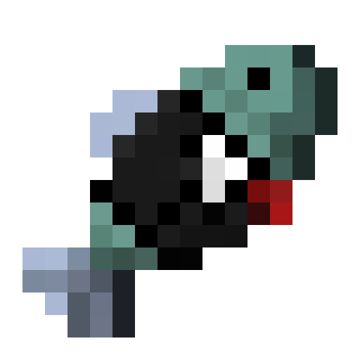

# FishSkin

HD skins, an in-game wardrobe, skin blocks and skin zones for Minecraft — with optional
[Figura](https://modrinth.com/mod/figura) and [Plasmo Voice](https://modrinth.com/plugin/plasmo-voice) support.

> **This mod was made 100% with AI (Claude by Anthropic).** Every line of code, every texture and this text were
> written by AI, directed by [m-catismeow](https://github.com/m-catismeow).

This branch (`1.20.x`) is for Minecraft **1.20.1** — Fabric and Forge.

| Branch | Minecraft |
|---|---|
| `main` | 1.20.x (1.20.1) |
| `1.21.x` | 1.21.1, 1.21.4 |

## Features

- **HD skins**: square PNG skins of 64, 128, 256, 512, 1024 or 2048 px (and the classic 64×32). Wide (Steve) or slim (Alex) arms.
- **Wardrobe**: press **K** (change it in *Options → Controls*) to open it. Keep up to 10 outfits (configurable),
  add skins with the button or by dropping PNG files onto the window, turn the 3D preview with the mouse.
- **Skin blocks**: right-click the *Skin Station* block, or any block you list in the config (a loom by default),
  to open the wardrobe. Sneak + right-click still uses the block normally.
- **Skin zones**: place a *Skin Zone* block (creative, operator blocks tab) and set its size. Inside the zone a
  message shows the open key, or the wardrobe opens by itself (`openOnEnter`).
- **Figura** (optional): each outfit can carry a Figura avatar that loads with the skin. The picker shows every
  avatar with its own colour mark, name and authors, and has a search box.
- **Plasmo Voice** (optional): give an outfit a second "talking" skin (for example with an open mouth); it shows
  only while your voice is actually loud enough, not just while push-to-talk is held.
- **Private**: skins are never written to disk. The server keeps the skins of online players in memory only and
  drops them when they leave; clients do not cache other players' skins.

## Install

1. Install the mod loader: [Fabric](https://fabricmc.net/) (plus [Fabric API](https://modrinth.com/mod/fabric-api)) or [Forge](https://files.minecraftforge.net/).
2. Put the FishSkin jar for your loader and Minecraft version into the `mods` folder.
3. For multiplayer, install it on the **server and on every player's game**. The server shares the skins.

Figura and Plasmo Voice are optional; the matching features appear when they are installed.

> **Figura: remember to take the avatar off.** An outfit without a Figura avatar keeps whatever avatar Figura has
> loaded right now. When you switch to an outfit that has no avatar set, or you stop using Figura, open Figura's own
> menu and unload your avatar (or turn Figura off) — otherwise the old avatar stays on top of the new skin.

## Configuration

The first start writes `config/fishskin.json`. It is JSON with `//` comments, and every setting is explained
inside the file. Restart the game or server after editing.

Settings marked **[server]** are decided by the server: when you join one, its values are used and your own file
is ignored for them. In singleplayer your own file is used. **[client]** settings always come from your own file.

| Setting | Default | Side | What it does |
|---|---|---|---|
| `openKeyAnywhere` | `true` | server | The open key works everywhere. `false`: only inside a skin zone or while looking at a skin block. |
| `zones.enabled` | `true` | server | Skin zones work. |
| `zones.openOnEnter` | `false` | server | Needs `zones.enabled`. The wardrobe opens by itself when a player enters a zone; otherwise a message shows. |
| `zones.message` | `Press {{button}} to change your skin` | server | Message inside a zone; `{{button}}` becomes the open key. |
| `zones.defaultWidth` / `defaultLength` / `defaultHeight` | `8` / `8` / `4` | server | Size of a newly placed zone, in blocks (1–256). |
| `blocks.enabled` | `true` | server | Right-clicking skin blocks opens the wardrobe. |
| `blocks.skinStation` | `true` | server | The mod's own Skin Station block opens the wardrobe. |
| `blocks.list` | `["minecraft:loom"]` | server | Game or modded blocks that open the wardrobe, by id (`"loom"` = `"minecraft:loom"`). |
| `blocks.message` | `Right-click to change your skin` | server | Message while looking at a skin block. |
| `maxOutfits` | `10` | server | Outfits per player; `-1` = unlimited. |
| `maxSkinSize` | `2048` | server | Largest skin the server accepts (64–2048 px). Big skins use more video memory on every player's PC. |
| `figura.enabled` | `true` | client | Outfits can carry a Figura avatar. |
| `plasmoVoice.enabled` | `true` | client | Talking skins. |
| `plasmoVoice.minLevelDb` | `-40` | client | How loud your voice must be (dB, -127 silent … 0 loudest). Normal speech is about -30 to -15. |
| `plasmoVoice.holdMs` | `200` | client | How long the mouth stays open after you stop making sound (ms). |

## Building

Needs a JDK (17 for 1.20.1, 21 for 1.21.x). Each folder (`fabric-<version>`, `forge-<version>`) is a Gradle
project; the code they share is in `common/`.

```
cd fabric-<version>
./gradlew build        # Windows: gradlew.bat build
```

The jar is in `build/libs/`. `build.sh` / `build.bat` build every folder of this branch.

## License

[zlib](LICENSE): use, change and share it for anything, including commercially, with no warranty — the author is
not responsible for anything that happens from using it. Bundled third-party code is listed in
[THIRD_PARTY_NOTICES.md](THIRD_PARTY_NOTICES.md).

Not an official Minecraft product. Not approved by or associated with Mojang or Microsoft.
